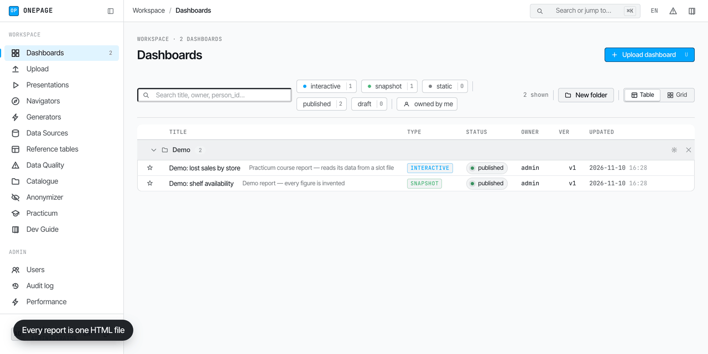
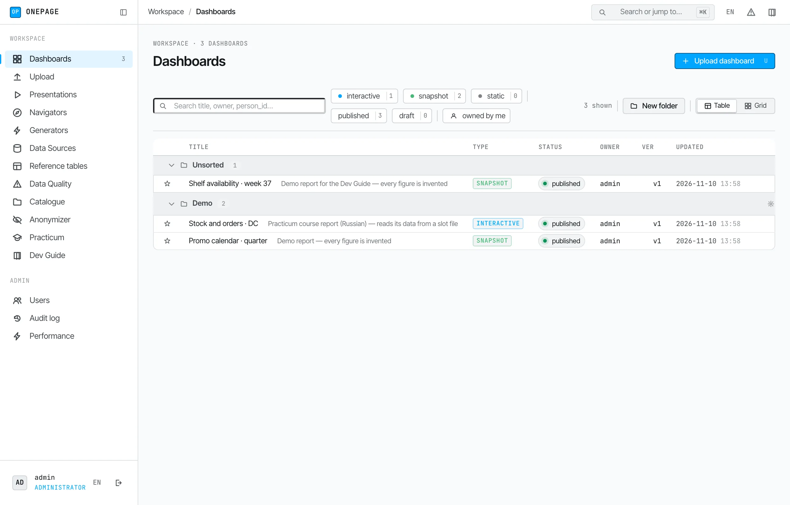
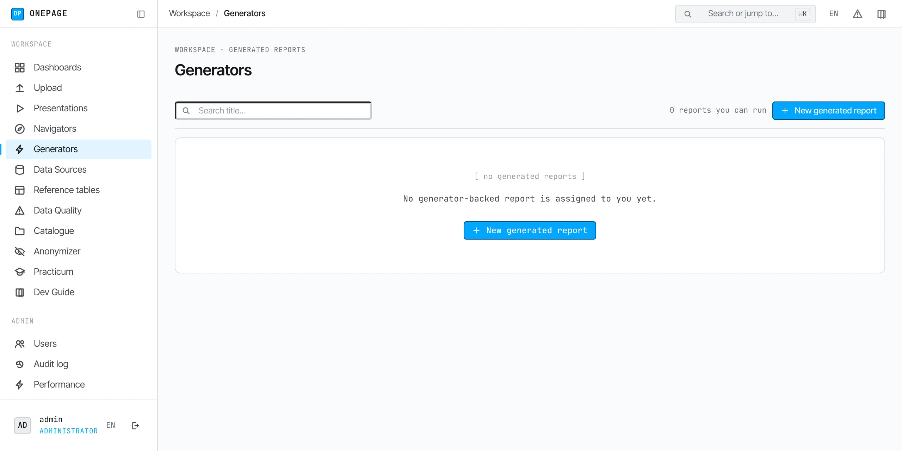

# OnePage

**People already build HTML pages with AI.** A report, a prototype, a deck for
a big meeting — a model writes it in an evening, as one file. You cannot
forbid it: it is faster, and the result is better.

Then the file has nowhere to go. It travels by e-mail, lands on a shared
drive, and a week later nobody knows which version is right or who may see it.

**OnePage is the place for those pages inside a company.** Upload the file and
it gets an address, a list of people who may open it, and a version history.
A colleague can publish a fix; you can roll it back.

The AI itself never enters your network. OnePage runs with no internet and
sends nothing out: the model stays where you allow it, and only the finished
page comes in. That makes it fit companies that do not let AI into their
perimeter yet.

What people do with it: publish reports, prototype future portals and internal
apps, prepare presentations. And simply make beautiful things — because now
anyone can, not only those who code.

[](https://github.com/onepage-bi/onepage/actions/workflows/ci.yml)
[](LICENSE)



Eleven seconds: the report list, a report with access control and versions
behind it, and the same report downloaded as one file and opened from disk —
no server, same numbers.

Two things worth knowing before the quickstart. **A page stays a single
file**: anyone with the right can download it with its data and open it later
from a laptop. And **data can stay on the analyst's machine**: a generator
runs in their own browser, reads the folder they point it at, and uploads only
the result.

## Try it

```bash
git clone https://github.com/onepage-bi/onepage.git && cd onepage
make demo       # builds the container, starts it on http://localhost:8000, loads demo data
```

Open <http://localhost:8000/dev-login> and sign in as `admin`. Without Docker:
`make venv && make run` (Python 3.12 or 3.13). `make help` lists every target.

## Install on a server

**With internet on the server:**

```bash
docker pull ghcr.io/onepage-bi/onepage:latest
```

then take `docker-compose.yml` and `env.template` from
[`deploy/release/`](deploy/release/) and follow
[`INSTALL.md`](deploy/release/INSTALL.md) from step 2.

**With no internet on the server:** download
`onepage-<version>-amd64.tar.gz` from the
[latest release](https://github.com/onepage-bi/onepage/releases/latest). The
image is inside the archive, nothing is pulled or built on the server. Unpack
it and follow the `INSTALL.md` it contains: load the image, set the address
and an admin password, `docker compose up -d`.

Sign-in is by password out of the box. OIDC and SAML single sign-on are
configured in `.env`; see [`docs/DEPLOY.md`](docs/DEPLOY.md).

## What you get



| | |
|---|---|
| **A list of pages** | Folders, favourites, search; everyone sees only what they may open |
| **A page with an address** | `/d/{id}` — access list, version history with roll-back, share links, annotations |
| **Upload** | Drop an HTML file; a new version of an existing page is one more upload |
| **Presentations** | Pages, images and PDFs shown as slides, for a room |
| **Navigators** | Link pages that point at reports and at other systems |
| **Admin** | Users, audit log, performance, errors by page |
| **A page as one file** | Download a page together with its data and open it from disk |

The page stays what it was — a standalone HTML document. It runs in a
sandboxed iframe with no `allow-same-origin`, and everything that crosses
that boundary is an explicit `postMessage` contract, so the platform never
has to trust the document. The file you uploaded is kept untouched.

Stack: FastAPI and SQLAlchemy over SQLite, Jinja2 templates, plain JavaScript
with no build step. One container, one data folder to back up.

## Optional parts

Everything above works on its own. These are there when you need them:

| | |
|---|---|
| **Generators** (`/generators`) | Python that builds a report from a folder of workbooks, run **in the analyst's browser**: the files are read on their machine. Needs a Chromium-based browser |
| **Data pages** (`/data-sources`, `/data-quality`, `/catalog`, `/reference`) | Where a generated report's numbers came from, checks on that data, shared lookup tables |
| **Anonymizer** (`/anonymizer`) | De-identify a spreadsheet entirely in the browser before showing a sample to a model; the page cannot send the file anywhere |
| **Practicum** (`/learn`) | Two hands-on courses on building a first report |
| **Desktop mirror** (`agent/`) | Keeps published pages readable on a Windows machine while the server is down. Early; see `agent/README.md` |
| **Quests** (`/quests`) | Off by default (`OP_QUESTS_ENABLED=true`): a daily-return game for a team rollout |
| **Explore** (`/explore`) | Off by default (`OP_EXPLORE_ENABLED=true`), a preview: questions and SQL over a folder of workbooks |



### What leaves the browser when a generator runs

A generator reads the analyst's workbooks locally, and that part is real: the
files are opened through the File System Access API and parsed in a Pyodide
worker on their machine. It does not follow that nothing reaches the server,
and the difference matters enough to spell out.

Out of the box, these do cross the network:

- **Parsed partitions.** After a run, the folder's parsed data is published as
  Parquet to `/api/dashboards/{id}/lake/parts` so the server can answer
  questions about it without re-reading the folder. This is **on unless the
  generator's manifest says `"lake": false`** (`lakeEnabled` in
  `static/js/gen-engine.js`), and `OP_LAKE_EXEC` is on by default.
- **Supporting files** an analyst attaches to a run (`aux_inputs`) are
  uploaded and stored with the run.
- **Data Quality samples.** Up to five raw cell values per failing check and
  the top values of a profiled column are sent to the server so a finding can
  show what it found.

What never reaches a language model, in any configuration: cell values. The
prompts carry table, column and view names, the author's own descriptions and
the frozen semantics — never a row. That boundary is enforced in code and
pinned by tests (`tests/smoke_explore_intent.py`), and it is a different
boundary from the one above.

If you need a generator whose data truly stays on the machine, set
`"lake": false` in its manifest and turn `OP_LAKE_EXEC` off. If you need to
hand a workbook to someone outside, `/anonymizer` is the tool that never
uploads anything at all.

## Status

* **An early release.** It has run in one production installation so far;
  nobody has deployed it independently yet. Tell us where you hit a rough edge.
* The trust boundaries of the product are written down in
  [`SECURITY.md`](SECURITY.md).
* OIDC sign-in is tested against a stub provider, not yet against a live
  Keycloak or Entra.
* Generators and folder access need a Chromium-based browser (Chrome, Edge):
  Firefox and Safari do not implement the File System Access API.
* The desktop mirror has been exercised on macOS only; its Windows path is
  partly verified.
* Explore is a preview and needs extra browser-engine files (`make assets`,
  about 105 MB); details in [`docs/ENGINE2.md`](docs/ENGINE2.md).
* The interface speaks English, Russian and Traditional Chinese (Hong Kong).

## When to use something else

- ad-hoc SQL over a warehouse with charts rendered on the server — Metabase,
  Apache Superset;
- authors who are developers and want code notebooks — Evidence, Observable;
- a vendor-supported stack tied to directory groups and desktop designers —
  Power BI Report Server and its peers.

## Development

```bash
make test                      # smoke tests: python + node + i18n
python3 tests/run_all.py       # the full suite, about two minutes
python3 tests/run_all.py --list
make lint                      # i18n catalogue check + node --check on static/js
ruff check .                   # errors only (E9/F63/F7/F82) — see pyproject.toml
```

Node.js is required for the DOM harnesses and for `make lint`. The Chrome layer
is skipped unless you pass `--chrome` or set `CHROME_BIN`.

```
app/            FastAPI app: api/ routes, services/ logic, models.py, migrations/
templates/      Jinja2 — pages/ is one file per address
static/js/      vanilla JS, no bundler; explore2/ is the engine-v2 worker
static/py/      Python that runs inside the browser (Pyodide)
engine/         Rust crate compiled to wasm for engine v2
agent/          desktop mirror and local run agent (Windows target)
tools/          one-off scripts: screenshots, fixtures, i18n, checks
tests/          smoke_*.py, *_dom.js, engine2/, chrome/
docs/           design records; docs/PERF_DECISIONS.md holds 23 ADRs with measurements
deploy/         asset fetchers, bundle/patch builders, backup drill
```

CI (`.github/workflows/ci.yml`) runs lint, the Python layer on Ubuntu and macOS,
the Node layer, and a SAML job that installs the optional dependency.

For a coding agent asked to install OnePage or write a page for it, see
[`AGENTS.md`](AGENTS.md); a machine-readable summary is in [`llms.txt`](llms.txt).

## License

Apache License 2.0 — see [LICENSE](LICENSE) and [NOTICE](NOTICE).

* [CONTRIBUTING.md](CONTRIBUTING.md)
* [SECURITY.md](SECURITY.md)
* [CODE_OF_CONDUCT.md](CODE_OF_CONDUCT.md)
